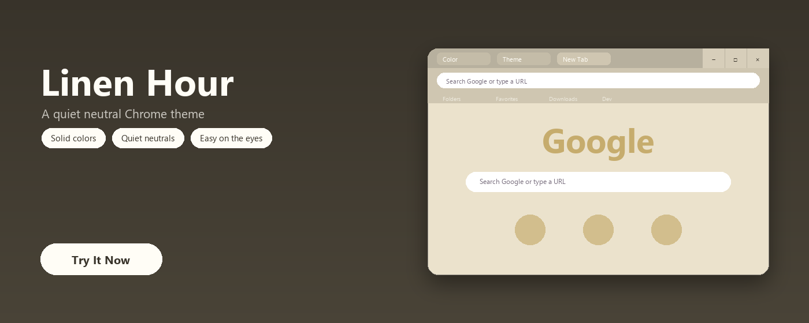
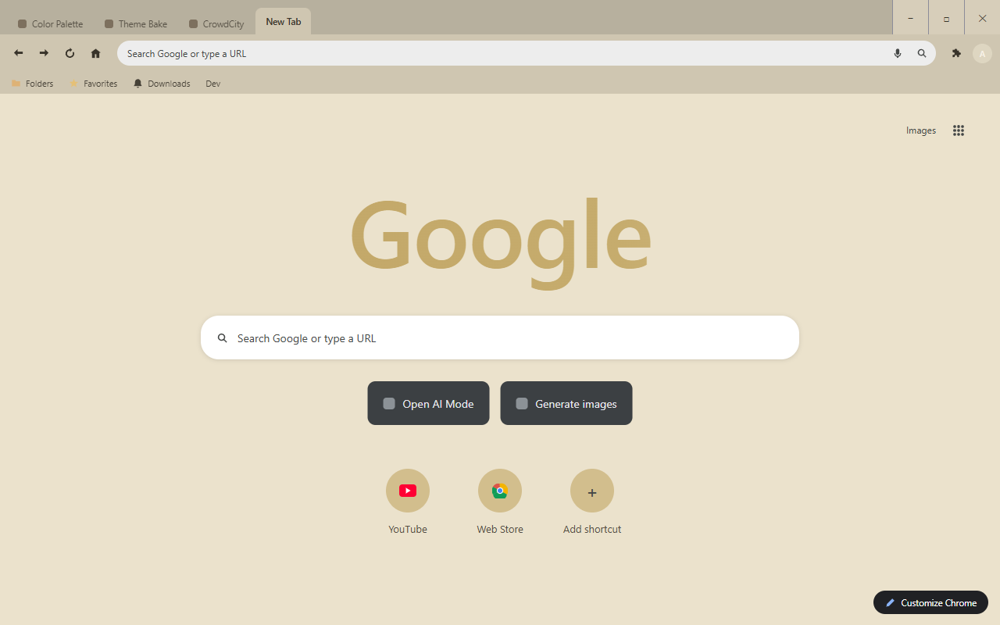
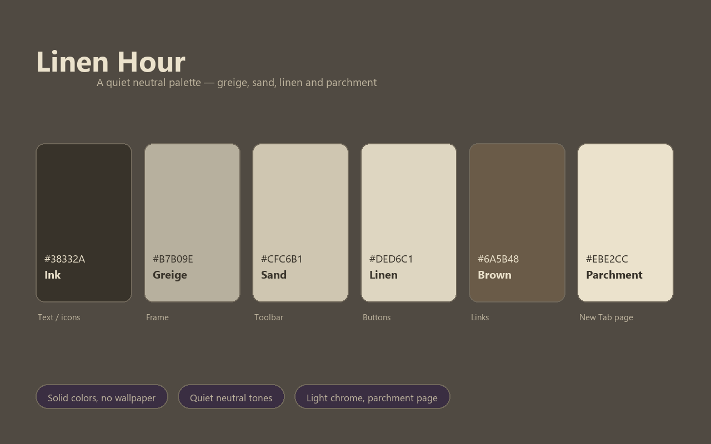

<p align="center">
  
</p>

<h1 align="center">Linen Hour Theme</h1>

<p align="center">
  A quiet neutral Chrome theme: greige chrome, a sand toolbar and a parchment New Tab Page.
</p>

<p align="center">
  
  
  
  
</p>

<p align="center">
  
</p>

## Overview

Linen Hour is the quiet end of the afternoon: a greige strip, a sand toolbar, and a parchment New Tab Page where the Google mark sits in soft sand gold. Deep ink brown keeps every tab, bookmark and toolbar icon readable on the warm neutrals, and nothing in the palette raises its voice.

## Design Concept

The reference palette is four near-identical greys with almost no saturation. Two choices make it usable as a theme:

1. **Pick the widest three depths for the surfaces** — greige `#B7B09E` frame, sand `#CFC6B1` toolbar, parchment `#EBE2CC` page.
2. **Add one ink from outside the palette** — deep brown `#38332A` (≈5.9:1 on the frame, ≈9.6:1 on the page), with a slightly lifted brown for links (≈5.5:1).

| Color | Hex | RGB | Role |
|---|---|---|---|
| Ink | `#38332A` | 56, 51, 42 | Text / icons |
| Greige | `#B7B09E` | 183, 176, 158 | Frame |
| Sand | `#CFC6B1` | 207, 198, 177 | Toolbar |
| Linen | `#DED6C1` | 222, 214, 193 | Buttons |
| Brown | `#6A5B48` | 106, 91, 72 | New Tab links |
| Parchment | `#EBE2CC` | 235, 226, 204 | New Tab background |

## Features

- Pure color, no wallpaper — fast and distraction-free
- Quiet neutral palette: greige, sand, linen and parchment
- Light chrome with deep ink brown — ≈6:1 on the frame
- Tab text, bookmark text and toolbar icons all share the same ink
- Single-row shortcut row and a colour-matched mark for a clean New Tab Page
- No configuration needed — install and enjoy

## Screenshots

| Browser | Palette |
|:-:|:-:|
|  |  |

## Installation

### Load unpacked (development)

1. Download or clone this repository.
2. Open `chrome://extensions` in Chrome.
3. Enable **Developer mode** in the top right.
4. Click **Load unpacked** and select this folder (`linen-hour-theme`).
5. The theme is active immediately.

### Package for the Chrome Web Store

```
chrome://extensions → Pack extension → select this folder → linen-hour-theme.zip
```

Upload the resulting `.zip` to the [Chrome Web Store developer dashboard](https://chrome.google.com/webstore/devconsole).

## Store listing copy

Ready to paste into the store listing (also kept in `store-assets/store-description.txt`):

> Linen Hour is a quiet neutral Chrome theme: a greige frame, a sand toolbar and a parchment New Tab Page. Deep ink keeps every tab, bookmark and toolbar icon readable on the warm greige, with linen and sand accents. Solid colors only, no wallpaper.

## Project structure

| File | Purpose |
|---|---|
| `manifest.json` | Theme definition (single-file, inlined `theme` field) |
| `logo/logo.png` | 128×128 store icon (transparent background) |
| `store-assets/promo/440x280.png` | Small promo tile |
| `store-assets/promo/1400x560.png` | Marquee promo tile |
| `store-assets/screenshots/en/screenshot-1-browser.png` | Browser mockup screenshot (1280×800) |
| `store-assets/screenshots/en/screenshot-2-palette.png` | Palette introduction screenshot (1280×800) |
| `store-assets/store-description.txt` | Store listing description |
| `scripts/generate-logo-vector.py` | Render all SVG logo candidates with headless Chromium, export `logo/logo.png` from `SELECTED` |
| `scripts/generate-screenshot-headless.py` | Regenerate the browser mockup via Playwright |
| `scripts/generate-screenshot-2-palette.py` | Regenerate the palette screenshot |
| `scripts/generate-promo.py` | Regenerate both promo tiles (1400×560 window hero, 440×280 dot palette) |
| `LICENSE` | Non-Commercial License (English / 中文) |

## Regenerating assets

Every asset is code-generated, so nothing here is hand-drawn or hand-copied:

```bash
py -3 scripts/generate-logo-vector.py         # candidates + logo/logo.png
py -3 scripts/generate-screenshot-headless.py # store screenshot 1 (browser mockup)
py -3 scripts/generate-screenshot-2-palette.py # store screenshot 2 (palette)
py -3 scripts/generate-promo.py               # promo 440x280 + 1400x560
```

To ship a different icon candidate, change `SELECTED` at the top of `generate-logo-vector.py` and re-run, then re-run the three asset scripts so the promo and screenshots pick up the new logo.

## License

Linen Hour Theme is released under the Non-Commercial License. See `LICENSE` for full text (English / 中文).
